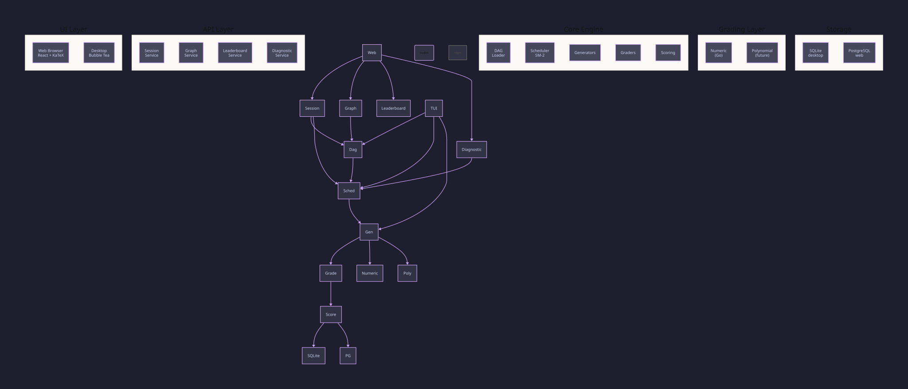
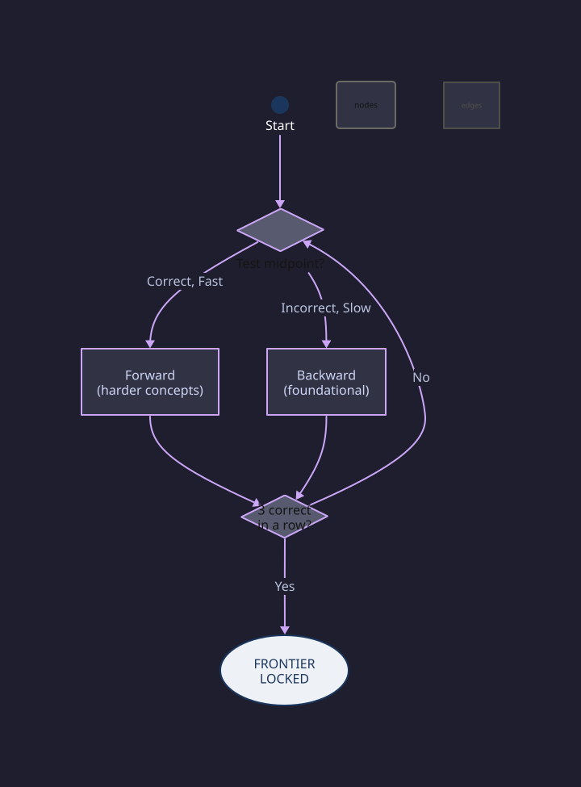

# Mathua Architecture

Mathua is a single Go binary with a web delivery mode. The engine core serves a single presentation layer.

## Five-layer architecture

The five layers are drawn above and described below. The diagram source is
`web/next-app/diagrams/architecture.d2`. The website renders it as an interactive graph.

### UI Layer — Web frontend, one engine

Mathua ships with a web frontend using React with Next.js, connecting to a shared Postgres database.

### API Layer — Four services, one router

The web server exposes a REST API through Go's standard `net/http` package. No external HTTP framework. Four services: Session (practice management), Graph (concept DAG visualisation), Leaderboard (weekly scoring), Diagnostic (adaptive testing).

### Core Engine — Five modules

- **DAG Loader** — Loads `data/concepts/*.json` plus `enrichment.json`, then validates no cycles and no orphans.
- **Scheduler (SM-2)** — Selects the next concept using priority scoring: recency, mastery, decay bonuses. Enforces prerequisite gating and 70/30 new/review balance.
- **Generators** — Every problem is generated on demand by a parameterised Go function. No static question bank.
- **Mastery & Spaced Repetition** — Tracks mastery via streak and response time. Simplified SM-2 algorithm schedules reviews.
- **Scoring** — Two scores: lifetime topic score (permanent) and weekly score (resets every Monday).

### Grading — nine types, six Go graders + SymPy

The `grading_type` on each concept selects the grader. One `Router` dispatches nine enum values. Six are pure Go. Three route to SymPy:

- **Numeric** — integer, float, fraction, mixed number, scientific notation (pure Go).
- **Choice** — case-insensitive multiple-choice matching.
- **Comparison** — comparison operators (`>`, `<`, `=`, `>=`, `<=`).
- **Ordering** — ordered sequences separated by delimiters.
- **Tuple** — coordinate/n-tuple parsing.
- **Complex** — `a + bi` forms.

**Symbolic, Polynomial, Expression** — routed through a long-lived Python subprocess running `grading/sympy_service.py`. The Go client sends a JSON expression pair over stdin. SymPy parses both into expression trees. SymPy then tests equivalence (`simplify(expected - answer) == 0`, with expand/factor/trigsimp/radsimp/powsimp and numerical verification). Python and SymPy are **installed in the production image** and pinned in `grading/requirements.txt`.

The image build verifies the installation, so grading is available in production. There is **no pure-Go equivalence fallback** for these types: the router sends all three straight to the subprocess.

### Storage — SQLite and Postgres

SQLite for local development (`mathua.db`, `WAL` `storage/sqlite.go:26`). PostgreSQL for production web access via `DATABASE_URL=postgres://` (`internal/storage/postgres.go:21` `PostgresStore` via `pgx/v5/stdlib`, `pgSchema` `postgres.go:21`, `GREATEST` for XP floor, `STRING_AGG` for activity). `cmd/mathua` checks `DATABASE_URL` and opens `pgx` when `postgres://` is set, otherwise SQLite. The data schema is identical across both databases, abstracted behind a `Repository` interface (`internal/storage/store.go`).

## Administration

Administration has its own document: [`administration.md`](administration.md) covers the four
roles, the permission model, invitations, the last-owner invariant and the audit log.

## Diagnostic — Computerised Adaptive Testing

Locates a student's knowledge frontier using a compressed covering set + info-gain CAT (`internal/diagnostic/cat.go`, `internal/diagnostic/report.go:11`). The engine builds a minimal covering set of the DAG. It repeatedly picks the concept that gives the maximal entropy reduction. It propagates `+0.3` evidence to prerequisites on correct and `-0.3` to dependents on incorrect and tracks per-concept `KnowledgeConfidence 0–1`. The frontier is the highest belief drop. A supplemental diagnostic runs when confidence `<0.7`.

`minTotalQuestions=25` and `maxTotalQuestions=45` bound the assessment (`internal/diagnostic/cat.go:33-35`). The engine does not test all 1250 concepts.

The engine asks two probes per concept in the cover. It stops at 25 questions once the cover is finished. A narrow scope runs out of cover first and stops sooner. A five-concept scope asks ten questions and still reports `min_total: 25`. The engine does not pad the difference.

The engine targets `80%` difficulty via `engine.computeDifficulty` (`internal/engine/engine.go:552`, `weakness→difficulty` 0.3–0.8).

## Full documentation

For interactive D2 diagrams, internal module detail and formatted code blocks, see the **[Architecture docs](https://mathua.vercel.app/docs/architecture)** in the web app.
